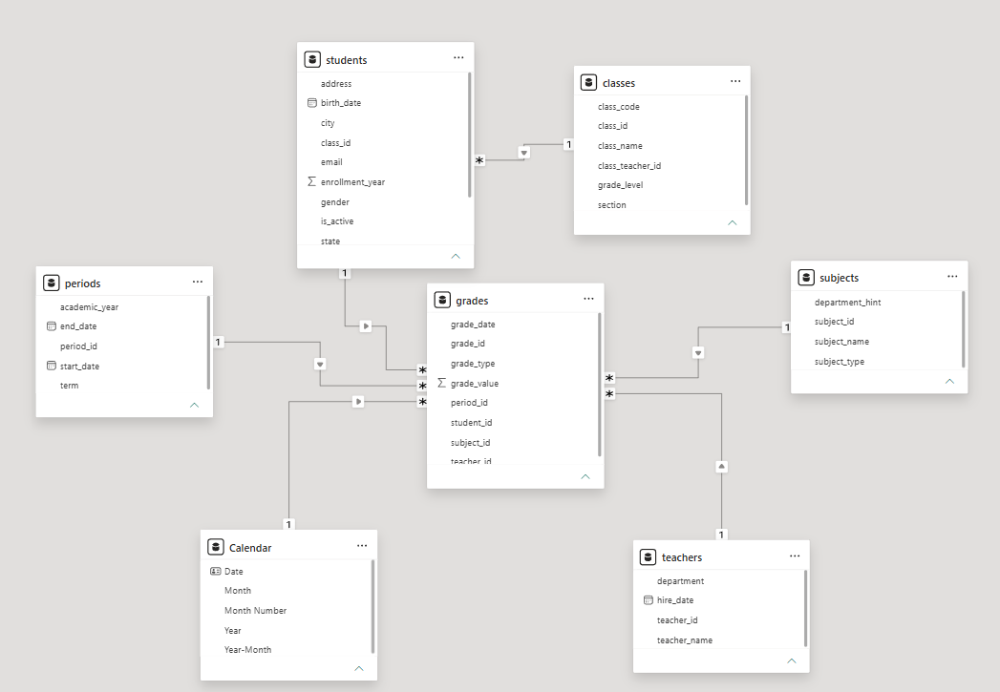
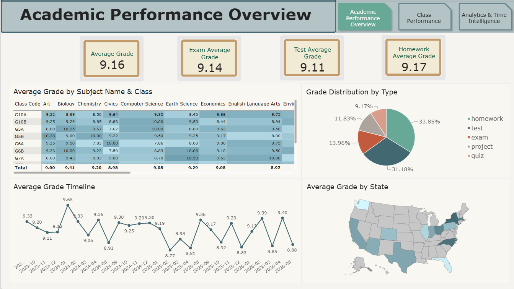
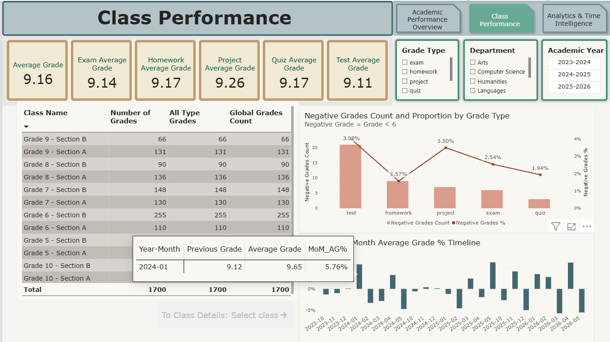
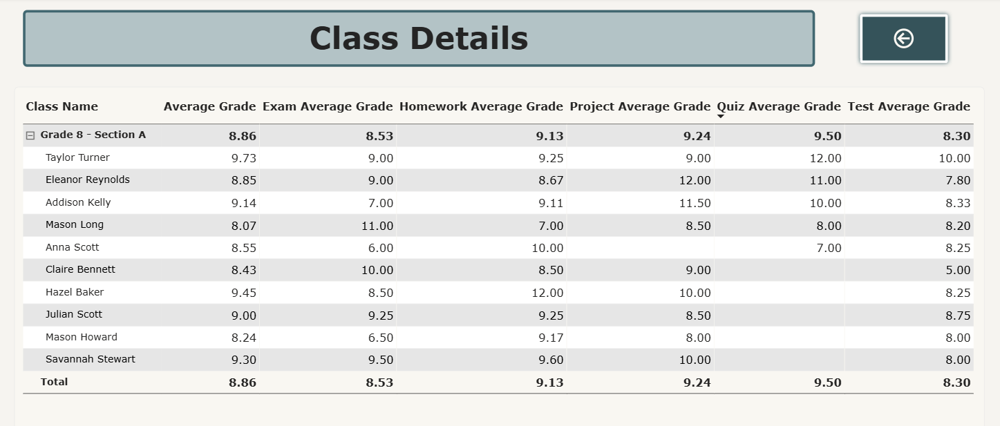
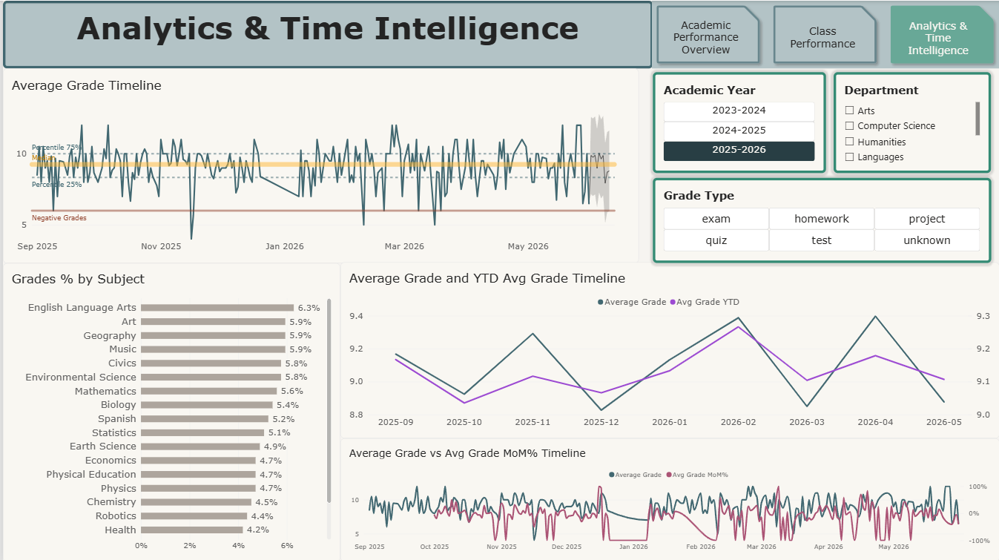

# Academic Performance Analytics | Power BI

## Project Overview

This project focuses on analyzing student academic performance using Power BI. The goal is to transform raw educational data into an interactive analytical dashboard that helps explore student results, identify performance trends, compare classes and subjects, and monitor academic progress over time.

The project covers the complete data analytics workflow, from data preparation and modeling to DAX calculations and interactive dashboard development.

## Business Objectives

The analysis aims to answer the following questions:

- What is the average grade across subjects and classes?
- How does academic performance change over time?
- Which classes and subjects demonstrate the best results?
- How are grades distributed across different assessment types?
- How many negative grades do students receive?
- Which students may require additional academic support?
- What are the monthly and year-to-date performance trends?
- What can historical performance data tell us about future results?

## Dataset

The dataset simulates an electronic school grading system and consists of six CSV files:

| Dataset | Description |
|---|---|
| students | Student information |
| classes | Class information |
| teachers | Teacher information |
| subjects | Subject information |
| periods | Academic periods |
| grades | Student grades and assessment records |

The `grades` table serves as the central fact table, while the remaining tables provide descriptive information for analysis.

## Tools & Technologies

- **Power BI** — data modeling, DAX calculations and visualization
- **Power Query** — data cleaning and transformation
- **DAX** — calculated columns, measures and time intelligence

## Data Preparation & Modeling

- Imported and transformed multiple CSV files using Power Query.
- Standardized data types and date formats using the en-US locale.
- Checked primary and foreign keys for missing and duplicate values.
- Built a Star Schema data model.
- Created a dedicated Calendar table using DAX.
- Established one-to-many relationships with single-direction filtering.

## DAX & Analytical Techniques

- CALCULATE, ALL and filter context modification.
- Measures with different filter behavior.
- Average Grade and grade-type-specific measures.
- Negative Grades Count and Negative Grades Percentage.
- Previous Grade and Month-over-Month (MoM%) calculations.
- Year-to-Date (YTD) calculations.
- Median and percentile analysis.
- Forecasting and trend analysis.

## Dashboard Pages

The report includes four analytical pages:

### 1. Academic Performance Overview
Provides a high-level overview of academic performance through KPI cards, subject and class comparisons, grade distribution, and geographical analysis.

### 2. Class Performance
Analyzes academic results across classes and assessment types, including average grades and negative grade statistics.

### 3. Class Details
Provides student-level performance analysis through drill-through functionality.

### 4. Analytics & Time Intelligence
Explores academic performance trends using percentiles, median, forecasting, YTD calculations and monthly comparisons.

## Key Power BI Features

- Interactive dashboards and KPI cards.
- Calculated columns and measures using DAX.
- Drill-down and drill-through functionality.
- Custom tooltip pages.
- Page-level filters and slicers.
- Cross-filtering and visual interactions.
- Conditional formatting.
- Time intelligence calculations.
- Forecasting and trend analysis.
- Consistent dashboard layout and navigation.

## Key Takeaways

This project demonstrates the ability to work with raw data, prepare and model datasets, develop DAX calculations with different filter-context behaviors, and build interactive Power BI reports for business analysis.

It combines data preparation, analytical modeling, time-based analysis and data visualization into a single end-to-end analytics project.
